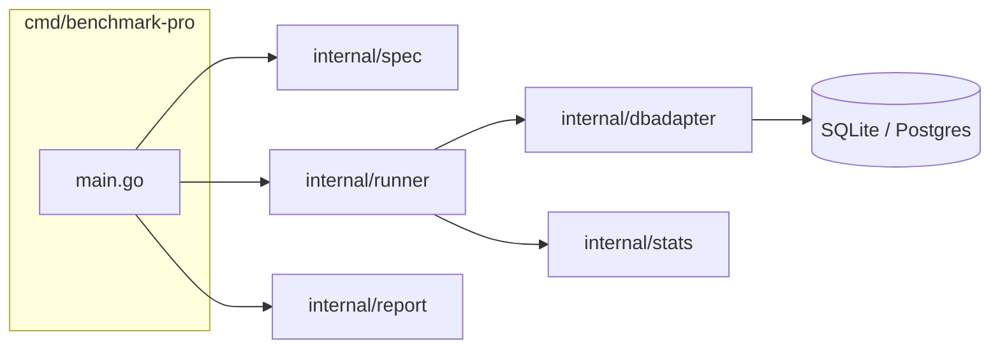
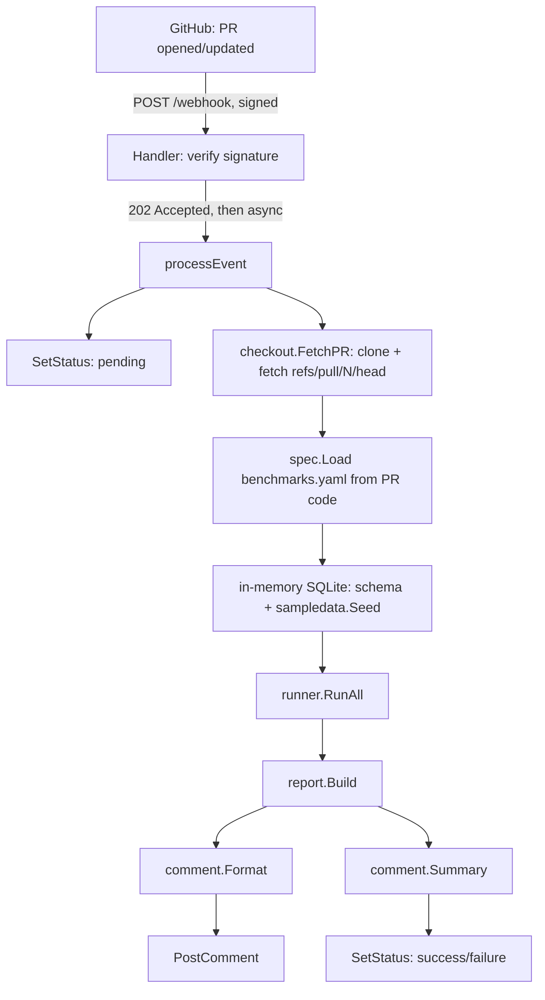

# BenchmarkPro (Go): Design Document (Weeks 1-2)

This mirrors `docs/DESIGN.md` in the Python version — same architecture, same spec format,
same JSON result schema — with the Go-specific implementation decisions below.

## 1. Goal

See the Python version's DESIGN.md §1. The Go port exists so the team can compare a
Go and a Python implementation of the same benchmark runner, or standardise on Go for the
GitHub webhook service in weeks 3-4.

## 2. Package layout

`internal/` keeps these packages unimportable outside the module, matching the Python
version's expectation that only the CLI and, later, the webhook service call into them.

## 3. Dependency choices

The sandbox this was built in only allows outbound access to `github.com` and
`codeload.github.com` for Go — not `proxy.golang.org`, `sum.golang.org` or `gopkg.in`.
`GOPROXY=direct GOSUMDB=off` fetches modules straight from their Git host, so every
dependency had to (a) live on GitHub directly and (b) not pull in a transitive dependency
that doesn't. That ruled out `gopkg.in/yaml.v3` and pure-Go SQLite drivers vendored under
`modernc.org`. Confirm `go build` works the same way on your own network — with normal
proxy access any of those would work too, and there is nothing Go-specific about this
constraint once you're off this sandbox.

| Need | Package | Why this one |
|---|---|---|
| YAML | `github.com/goccy/go-yaml` | Hosted directly on GitHub, no transitive deps off GitHub |
| SQLite | `github.com/mattn/go-sqlite3` | The standard cgo driver; self-contained (bundled C source) |
| Postgres | `github.com/lib/pq` | Pure Go, no cgo, hosted on GitHub |

Both drivers implement `database/sql`, so `internal/dbadapter` is one implementation with an
`engine` switch, rather than two adapter types like the Python version's `SQLiteAdapter` /
`PostgresAdapter`. `%s` in the spec is rewritten per engine: `?` for SQLite, `$1, $2, ...`
for Postgres.

## 4. Measurement method

Same as the Python version: `time.Now()`/`time.Since()` (monotonic in Go) around
execute-and-fetch-all, inside a transaction that is rolled back by default, with 1 warm-up
run discarded before the measured runs. p99 is nearest-rank and equals max at `runs: 10` —
that's correct math, not a bug.

## 5. Result schema

Identical to the Python version's, field for field, except `"python"` becomes `"go_version"`.
This is deliberate: whichever language ends up running in CI, the JSON a baseline comparison
step reads doesn't change.

## 6. Testing

`go vet` is clean and 15 tests cover the same cases as the Python suite: stats math,
spec validation (6 invalid-spec cases), rollback behavior, a broken query not crashing the
run, deterministic seeding (checked via a `SUM(id * user_id)` checksum rather than Python's
full-row equality, since Go's `database/sql` returns typed values that are more work to
compare row-by-row), and a full CLI run asserting on the JSON it writes.

## 6a. Weeks 3-4: GitHub webhook

**Signature verification (`internal/webhook`).** HMAC-SHA256 over the raw request body,
compared with `hmac.Equal` (constant-time, avoids a timing side-channel). Checked before the
body is parsed or trusted for anything — an unverified payload could otherwise trigger
arbitrary clones and forged-looking comments.

**Why `refs/pull/<N>/head` instead of fetching by SHA.** GitHub always exposes a PR's head
commit under this ref, including PRs from forks where the SHA may not otherwise be reachable
from a plain clone. `internal/checkout` fetches this ref specifically rather than relying on
`git fetch <sha>` (which needs server-side support for fetching arbitrary SHAs that isn't
always enabled).

**Why in-memory SQLite, and why the server refuses Postgres specs.** Each webhook delivery
gets a fresh `:memory:` database, so concurrent PRs never share state and nothing needs
cleanup. Doing the same for Postgres needs either a pooled set of throwaway databases or a
schema-per-run strategy — real infrastructure, not a two-line change — so for now
`processEvent` checks `sp.Database.Engine` and fails clearly rather than quietly running
against a Postgres instance that might be shared across concurrent PRs. That's a deliberate
scope cut, not an oversight, and the README says so.

**Why commit-status API, not Checks API.** The Checks API gives richer UI (collapsible
sections, separate named checks) but requires a GitHub App installation token; the commit
status API works with a plain personal access token, simpler to set up for V1. Both go
through `internal/ghclient.Reporter`, so swapping to Checks later touches one file.

**The 202-then-background pattern.** GitHub expects a webhook response within about 10
seconds; cloning a repo and running benchmarks can take longer. The handler verifies the
signature and parses the event synchronously (fast, worth failing loudly on), then
acknowledges and does the clone/run/report in a goroutine. `processEvent` is a plain function
taking a parsed event, not tied to the HTTP layer, specifically so tests can call it directly
against a local git fixture without a real webhook delivery.

**What the PR comment does NOT yet claim.** `internal/comment` states explicitly, in the
comment body, that baseline comparison isn't available yet. The commit status reflects only
"did every query run without error" — not performance. This matters because a half-built
regression check that looks complete is worse than an honest "not yet": a team that wires up
branch protection against this status today would be blocking merges on query *correctness*,
not *speed*, and should know that.

## 6b. Weeks 5-6: realistic test data

`internal/sampledata` (named to avoid Go's reserved `testdata` directory, which the toolchain
always excludes from builds) replaces the weeks 1-2 placeholder (1,000 users / 5,000 logs,
flat distribution) with:

- **Scale.** Defaults now 10,000 users / 50,000 logs, per the V1 brief's "insert realistic
  data (10K rows)".
- **Uneven log distribution.** Logs are assigned to users via `math/rand`'s built-in Zipf
  generator rather than `i % users`, so a small number of "active" users account for a
  disproportionate share of logs — closer to real traffic, and it actually changes which
  queries look slow: `logs_for_user` moved from roughly 130µs to the millisecond range once
  the table went from 5K flat rows to 50K Zipf-distributed rows, surfacing a missing-index
  cost the old seed data hid entirely.
- **Still deterministic.** Everything is seeded from a single `int64` (`Config.Seed`,
  default 42) and a fixed reference date (`2025-06-01`, not `time.Now()`) — same seed always
  produces byte-identical rows, verified by `TestGenerateIsDeterministic`.
- **CLI exposure.** `--users`, `--logs`, `--seed` flags let you shrink the dataset for fast
  local iteration or change the seed to test with a different random sample.

## 7. Known risks

Same as the Python version's §8, plus: the SQLite driver's cgo dependency means the CLI must
be built with a matching C toolchain for each target platform in CI (a plain
`GOOS=... GOARCH=... go build` will not work for cross-compiling SQLite support).

## 8. Out of scope through week 6

- **Baseline comparison and the 10% regression threshold (weeks 9-10).** Nothing in this
  codebase yet compares one report to another — `comment.Format` says this outright in the
  PR comment it generates, rather than quietly implying a check that isn't there.
- **Merge-blocking (week 11).** Branch protection can be pointed at the `benchmark-pro`
  status today, but since it only reflects "did queries run", not "did they regress", doing
  so blocks merges on correctness, not speed. Real regression-based blocking needs weeks
  9-11 first.
- **Postgres support in the webhook server.** The CLI supports Postgres; the server
  deliberately refuses `engine: postgres` specs with a clear error (see §6a) until there's a
  plan for isolating concurrent PR runs against it.
- **GitHub Checks API, richer PR UI, Slack notifications, Jenkins support** — all V2 items
  per the original brief, untouched.
